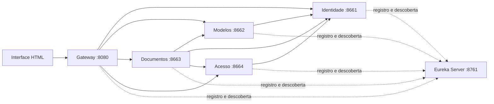

# API de Gerenciamento de Documentos

MVP acadêmico de um sistema de gerenciamento de documentos, organizado em quatro microserviços Spring Boot, com API Gateway e descoberta de serviços pelo Eureka Server.

O fluxo implementado permite cadastrar uma conta, autenticar, cadastrar um modelo e criar um documento a partir dele. A consulta individual verifica se o documento pertence ao usuário autenticado.

## Arquitetura



O Gateway é a entrada das APIs públicas. O Eureka mantém o registro dos quatro serviços e do Gateway; as requisições de negócio seguem diretamente para os serviços descobertos. As rotas internas de validação de sessão e autorização não são expostas pelo Gateway.

| Pasta | Aplicação | Porta local | Responsabilidade |
| --- | --- | --- | --- |
| `eureka-server` | Eureka Server | 8761 | Registro e descoberta |
| `gateway` | Gateway | 8080 | Rotas públicas e interface HTML |
| `identidade` | Identidade | 8661 | Usuários, senhas BCrypt e sessões |
| `modelos` | Modelos | 8662 | Cadastro e consulta do catálogo de modelos |
| `documentos` | Documentos | 8663 | Criação e consulta de documentos pessoais |
| `acesso` | Acesso | 8664 | Autorização pela propriedade do documento |

Cada serviço de domínio possui camadas `controller`, `service`, `repository`, `model` e `dto`, além de clientes HTTP e configuração. Os repositórios mantêm os dados em memória, sem tabelas compartilhadas.

## Tecnologias

- Java 21; Spring Boot 3.5.7 e Spring Cloud 2025.0.0.
- Spring Web, Bean Validation, Eureka, Gateway e LoadBalancer.
- Maven Wrapper e Python 3.10 ou superior para iniciar e testar o conjunto.
- HTML, CSS e JavaScript no Gateway.
- Docker Compose como alternativa de execução.

## Executar localmente

Requisitos: **JDK 21**, Python 3.10 ou superior e acesso à internet na primeira compilação para baixar Maven e dependências. Configure `JAVA_HOME` para o JDK 21. Não é necessário instalar Maven separadamente.

```bash
git clone https://github.com/gabrmascarenhas/api-microservices.git
cd api-microservices
python3 executar.py
```

No macOS, se o JDK 21 estiver instalado e registrado no sistema:

```bash
export JAVA_HOME=$(/usr/libexec/java_home -v 21)
python3 executar.py
```

O iniciador compila e testa o projeto, abre as seis aplicações e aguarda a saúde de cada uma. Os registros podem levar alguns segundos para aparecer no Eureka e ser descobertos pelos clientes.

- Sistema: <http://localhost:8080>
- Eureka: <http://localhost:8761>
- Logs locais: `.execucao/`
- Encerrar: **Ctrl+C** no terminal do iniciador.

Para reiniciar usando os JARs já compilados:

```bash
python3 executar.py --sem-build
```

O iniciador local usa um shell POSIX; no Windows, utilize WSL. Para compilar separadamente no Windows, use `mvnw.cmd clean verify`.

## Demonstração

1. Abra o sistema e expanda **Criar uma conta**. Use senha com pelo menos oito caracteres.
2. Entre com o email e a senha cadastrados.
3. Cadastre um modelo com nome e conteúdo.
4. Crie um documento escolhendo esse modelo.
5. Abra o documento na lista para executar a autorização pelo serviço Acesso.
6. Abra o Eureka para visualizar `IDENTIDADE`, `MODELOS`, `DOCUMENTOS`, `ACESSO` e `GATEWAY` registrados.

Não há credenciais predefinidas. O conteúdo do modelo é copiado para o documento, que guarda a versão de origem. Neste MVP, os modelos são cadastrados na versão 1; a edição e o versionamento do catálogo ainda não estão implementados.

## APIs públicas

Todas as rotas abaixo são acessadas pelo Gateway na porta **8080**.

| Método | Rota | Operação | Sessão |
| --- | --- | --- | --- |
| POST | `/api/identidade/usuarios` | Cadastrar usuário | Não |
| POST | `/api/identidade/login` | Obter token de sessão | Não |
| GET | `/api/identidade/me` | Consultar usuário autenticado | Sim |
| POST | `/api/modelos` | Cadastrar modelo | Sim |
| GET | `/api/modelos` | Listar catálogo | Sim |
| GET | `/api/modelos/{id}` | Consultar modelo | Sim |
| POST | `/api/documentos` | Criar documento a partir de um modelo | Sim |
| GET | `/api/documentos` | Listar documentos do usuário | Sim |
| GET | `/api/documentos/{id}` | Consultar documento com autorização | Sim |
| GET | `/api/acesso/status` | Descrever a regra do MVP | Não |

Cadastro de usuário:

```json
{"nome":"Gabriel","email":"gabriel@example.com","senha":"UmaSenhaDeTeste123!"}
```

Login:

```json
{"email":"gabriel@example.com","senha":"UmaSenhaDeTeste123!"}
```

Nas operações autenticadas, envie o token retornado no login:

```http
Authorization: Bearer SEU_TOKEN
```

Cadastro de modelo:

```json
{"nome":"Relatório","conteudo":"Conteúdo inicial do relatório."}
```

Criação de documento:

```json
{"titulo":"Meu relatório","modeloId":"ID_RETORNADO_NO_CADASTRO_DO_MODELO"}
```

Respostas: `201` no cadastro, `400` para dados inválidos, `401` para sessão ou credenciais inválidas, `403` para acesso negado, `404` para recurso inexistente, `409` para duplicidade e `503` quando uma dependência chamada pelo cliente HTTP está indisponível.

## Testes

Compilação e testes de inicialização dos seis módulos:

```bash
sh mvnw clean verify
```

Com os serviços iniciados e descobertos pelo Eureka, em outro terminal:

```bash
python3 testar_mvp.py
```

O teste integrado valida os cinco registros no Eureka, a página inicial, cadastro e login, criação de modelo e documento, listagem por proprietário e rejeição de credenciais inválidas, duplicidade e acesso por outro usuário. Ele cria registros de teste em memória.

## Docker Compose

Requer Docker com o daemon em execução e o plugin Compose. Defina uma chave interna compartilhada antes de iniciar:

```bash
export INTERNAL_KEY="$(python3 -c 'import secrets; print(secrets.token_hex(32))')"
docker compose -f compose.yaml up --build
```

Acesse os mesmos endereços do Gateway e do Eureka. As portas dos serviços de domínio não são publicadas no host. Aguarde a descoberta dos serviços antes de executar o fluxo.

Para encerrar:

```bash
docker compose -f compose.yaml down
```

A configuração Docker está disponível; a validação integrada desta versão foi realizada com execução local em JDK 21, sem Docker.

## Configuração

| Variável | Uso local padrão | Finalidade |
| --- | --- | --- |
| `JAVA_HOME` | JDK configurado no ambiente | Compilação e execução local |
| `EUREKA_URL` | `http://localhost:8761/eureka/` | Endereço do registro |
| `SERVICE_HOST` | `localhost` | Host anunciado no Eureka |
| `BIND_ADDRESS` | `127.0.0.1` | Interface de escuta |
| `INTERNAL_KEY` | Chave demonstrativa local | Autenticação entre endpoints internos |

O Compose exige `INTERNAL_KEY` e configura os nomes dos serviços na rede Docker. A chave demonstrativa padrão existe para execução local; use uma chave própria se alterar o ambiente.

## Limites e próximas etapas

- Dados e sessões ficam em memória: reiniciar os serviços elimina os registros correspondentes.
- Tokens de sessão expiram após uma hora. O botão Sair descarta o token no navegador; não implementa revogação no servidor.
- A autorização atual permite consulta individual apenas pelo proprietário. Perfis administrativos, aprovação, bloqueio de conta e compartilhamento ainda são evoluções.
- A interface atual usa HTML e JavaScript, sem React.
- Persistência, exportação TXT/PDF e os nove padrões GoF completos previstos para a evolução ainda não estão implementados.

Esta entrega demonstra a arquitetura e um fluxo funcional mínimo; não representa a conclusão de todos os requisitos do projeto final.

## Documentação

As decisões adotadas no MVP estão registradas em [docs/adr](docs/adr/README.md), com contexto, alternativas, consequências e evidências no código.

## Base utilizada

Adaptação acadêmica do projeto [Spring Boot Eureka Discovery Server, Gateway e Microservices](https://github.com/sun-rishi/Spring-Boot-Eureka-Discovery-Server-Spring-Boot-Gateway-Microservices), de **sun-rishi**. A estrutura original foi aproveitada e adaptada ao domínio de gerenciamento de documentos.
